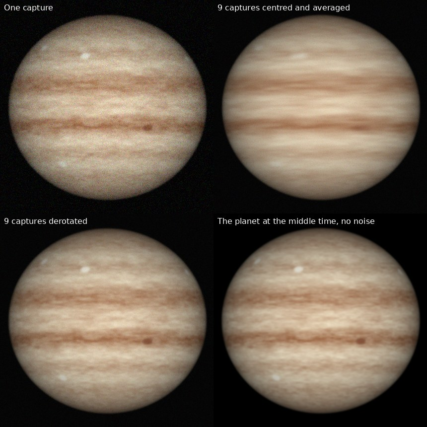

# FixMyPlanet

Open-source planetary derotation for Linux, Windows and macOS.

A planet turns while you image it. Jupiter carries a surface feature along by
about 0.6° per minute, so each capture has to be short, and several captures
taken over a quarter of an hour cannot simply be added together. FixMyPlanet
takes the stacked image of each capture, turns every one of them forward or
back to a single moment, and combines them. The result has the low noise of
the whole session without the smearing.



*A rendered test planet, not a telescope image: nine noisy captures two
minutes apart. Averaging them smears everything that moved; derotating them
first does not.*

## What it does

- **Derotates and combines** any number of stacked images of one session to a
  moment of your choice.
- **Combines R, G and B** captures taken one after the other into a colour
  image in which the three channels show the same moment.
- **Finds the planet by itself**: centre, size, and the direction of the axis
  from Jupiter's belts or Saturn's rings. You can correct the outline by hand.
- **Notices swapped north and south** from the direction in which the
  features move.
- **Leaves Saturn's rings alone** while the globe is derotated.
- **Fine-aligns** the images against each other, matches their brightness
  and compensates limb darkening.
- **Computes the planet's orientation** for any time: central meridian
  (Systems I, II and III for Jupiter), tilt, pole angle, diameter and phase.
- Planets: Mars, Jupiter, Saturn, Uranus, Neptune.
- Reads TIFF, PNG, FITS, JPEG and BMP. Writes 16-bit TIFF, PNG and FITS;
  8 bits on request, and floating point for TIFF and FITS.

There are two programs on the same library:

| Program | What it is |
|---------|------------|
| `fixmyplanet-gui` | desktop application (Qt 6) |
| `fixmyplanet` | command-line tool; does the same and can be scripted |

## Status

Version 0.1.0 is a first working version. Read this before relying on it.

- The planet's orientation is checked against JPL Horizons for all five
  planets (central meridian within 0.01°).
- Measurement and derotation are checked against rendered planets, where the
  right answer is known exactly. The numbers are in
  [docs/ALGORITHM.md](docs/ALGORITHM.md).
- **It has not yet been run on real telescope images**, and its output has
  not been compared with WinJUPOS. Real images have sharpening halos, moons,
  shadows and uneven seeing that the rendered test images lack. Check the
  outline on each image by eye.
- It is built and tested on Linux. The Windows and macOS builds come from the
  GitHub workflows in `.github/workflows`, which have not run yet.

[DEVELOPMENT.md](DEVELOPMENT.md) lists what is done, what was decided and why,
and what is still open.

## Getting it

There are no ready-made downloads yet; build it from source.

Requirements: a C++17 compiler, CMake 3.16 or newer, and Qt 6.2 or newer
(Widgets) for the desktop application. Everything else is in `third_party/`.

```sh
cmake -S . -B build -DCMAKE_BUILD_TYPE=Release
cmake --build build --parallel
ctest --test-dir build --output-on-failure
```

On Linux the programs are then `build/fixmyplanet` and
`build/src/gui/fixmyplanet-gui`.

On Debian or Ubuntu the requirements are `sudo apt install cmake g++ qt6-base-dev`.

| CMake option | Default | Meaning |
|--------------|---------|---------|
| `FIXMYPLANET_BUILD_GUI` | `ON` | build `fixmyplanet-gui`; switch off to build without Qt |
| `FIXMYPLANET_BUILD_TESTS` | `ON` | build the test-suite |
| `FIXMYPLANET_SANITIZE` | `OFF` | build with AddressSanitizer and UndefinedBehaviorSanitizer |

Pushing a tag such as `v0.1.0` runs `.github/workflows/release.yml`, which
builds an AppImage for Linux, a zip for Windows and a disk image for macOS
and puts them into a draft release. The macOS build is not signed with a
developer certificate: on first start macOS will refuse to open it until you
allow it under System Settings > Privacy & Security > "Open Anyway".

## What you need for a session

1. **Stacked images**, one per capture, from your usual stacking program
   (AutoStakkert, FTYS, ...), all processed the same way. For a 15-minute
   Jupiter session that is typically six to ten captures of about a minute
   each.
2. **The UTC time of the middle of each capture**, good to a few seconds.
   FixMyPlanet reads it from file names such as

   ```
   2026-01-10-2203_5-Jup.tif        WinJUPOS style (last digit: tenths of a minute)
   Jup_2026-01-10_22-03-30.tif
   Jup_20260110_220330.fits
   ```

   or from the FITS `DATE-OBS` header. Otherwise you type it in.
3. Roughly **which way is north** in the images (up or down), and whether
   they are mirror-reversed.

For R, G and B captures, put the filter letter in the file name as its own
word (`..._R.tif`, `...-G-...`), or enter it in the list.

## Using the desktop application

1. **File > Add images**, or drag the files into the window. Check the times
   in the list; double-click a time or a filter to change it.
2. Choose the **planet**.
3. Select an image and set its **north angle** roughly: 0 if north is up, 180
   if south is up. Tick **Mirror-reversed image** if a star diagonal or
   similar flipped the view.
4. Press **Measure all**.
5. **Look at the outline on each image.** The green line should follow the
   limb and the yellow line the equator. `N` marks the north pole, `p` the
   limb towards which the rotation carries the features. To adjust:

   | Action | Effect |
   |--------|--------|
   | drag | move the outline |
   | Ctrl + wheel | change its size |
   | Shift + wheel | turn it |
   | arrow keys | move by 0.1 pixel (with Shift: 1 pixel) |
   | Page Up / Page Down | radius by 0.1 pixel (with Shift: 1 pixel) |
   | Home / End | turn by 0.1° (with Shift: 1°) |
   | wheel, right-drag | zoom and pan the view |

6. Press **Derotate**, look at the **Result** tab and the report underneath,
   then **Save result**.

**File > Save session** stores the list of images with their times and
measurements in a small JSON file, which both programs read.

## Using the command line

```sh
# Measure the images and write a session file
fixmyplanet measure --planet jupiter --north-angle 180 -o night.json captures/*.tif

# Optional: draw the fitted outline on each image to check it
fixmyplanet overlay night.json --out-dir check

# Derotate and combine
fixmyplanet run night.json -o jupiter.tif

# Or both steps at once
fixmyplanet auto --planet jupiter --north-angle 180 -o jupiter.tif captures/*.tif

# Where is the planet's central meridian at a given time?
fixmyplanet ephem --planet jupiter --time 2026-01-10T22:03:30
```

`fixmyplanet help` lists every option. The ones you are most likely to want:

| Option | Meaning |
|--------|---------|
| `--north-angle DEG` | rough direction of the planet's north pole, counter-clockwise from up |
| `--mirror` | the images are mirror-reversed |
| `--time UTC` (once per image) | capture times, if the file names do not carry them |
| `--system I\|II\|III` | longitude system to follow (Jupiter; default II) |
| `--rate DEG_PER_DAY` | follow a rotation rate of your own |
| `--ref-time UTC` | derotate to this moment instead of the middle of the session |
| `--north-up` | write the result centred with north up |

### Trying it without a telescope

```sh
fixmyplanet synth --planet jupiter --out-dir practice --truth --colour
fixmyplanet auto  --planet jupiter -o practice/result.tif practice/jupiter_*.tif
```

`synth` renders a made-up Jupiter (or another planet) at nine moments two
minutes apart, with blur, noise and a wandering position, plus the noise-free
picture at the middle time for comparison.

## Conventions

- **Times** are UTC and refer to the middle of the capture. An error of ten
  seconds shifts Jupiter's features by 0.1°.
- **North angle**: direction of the planet's north pole in the image,
  measured counter-clockwise from "up". 0 = north up, 90 = north to the left,
  180 = south up.
- **Mirror**: set when the image is flipped. The image itself cannot show
  this; if it is set wrongly, north and south come out exchanged.
- **Longitude systems** (Jupiter): System I follows the equatorial zone,
  System II the rest of the visible surface including the Great Red Spot,
  System III the magnetic field. Over a session of 20 minutes Systems I and II
  differ by only 0.1°, so the choice hardly matters for derotation; it matters
  for the central meridian values printed in the report.
- **Central meridian** values are planetographic and include light time, as in
  the Astronomical Almanac.

## What to expect, and limits

- On rendered test planets with exact measurements, seven images spanning 18
  minutes combine into an image that differs from the true picture by 0.02 %
  of full brightness (RMS) over the inner disc. An image taken 9 minutes
  early, used as it is, differs by 3.3 %.
- The automatic measurement finds the centre to a few tenths of a pixel near
  opposition. Two systematic effects are known:
  - a blurred, limb-darkened edge is found about half a blur-width inside the
    true limb, so the radius comes out about a pixel too small;
  - away from opposition the unlit side has a soft edge, which pulls the
    centre towards the sunlit side by up to about 0.5 % of the radius.

  Neither matters much for derotation: the images are fine-aligned against
  each other afterwards, and in the tests an error of this size shared by all
  images made no measurable difference to the result. They do matter if you
  want to read off longitudes.
- The outermost few percent of the disc radius have little or no derotated
  data, because a point right at the limb was behind it a few minutes
  earlier. There the result goes over gradually into the plain average of
  the images.
- Saturn's rings, and everything else outside the globe, are averaged without
  derotation. The shadow of the rings on the globe is treated like a surface
  feature and smears slightly.
- Moons and their shadows move at their own rates and will smear.
- Every surface point is assumed to turn at the same rate. Jupiter's zones
  drift against each other by up to 7.6° per day (0.1° in 20 minutes).
- Not there yet: derotating the frames of a video before stacking,
  cylindrical and polar maps, measuring longitudes of features, Venus and
  Mercury.

## Repository layout

| Path | Contents |
|------|----------|
| `src/core` | the library: ephemeris, geometry, measurement, derotation, image files (no Qt) |
| `src/cli` | the `fixmyplanet` command-line tool |
| `src/gui` | the `fixmyplanet-gui` desktop application |
| `tests` | test programs and image fixtures |
| `docs/ALGORITHM.md` | how it works and how each part was checked |
| `DEVELOPMENT.md` | state, decisions, known limits, next steps |
| `third_party` | LodePNG, stb_image, VSOP87 |
| `packaging` | desktop entry and icon |

## Licence

FixMyPlanet is free software: you can redistribute it and/or modify it under
the terms of the GNU General Public License as published by the Free Software
Foundation, either version 3 of the License, or (at your option) any later
version (GPL-3.0-or-later). The full text of version 3 is in
[LICENSE](LICENSE). It comes with no warranty.

## Credits

- Planet positions: VSOP87 by P. Bretagnon and G. Francou (Bureau des
  Longitudes), in the public-domain C++ form by Greg Miller.
- Rotation models and shapes: IAU Working Group on Cartographic Coordinates
  and Rotational Elements (Archinal et al. 2018).
- Reference values for the tests: JPL Horizons.
- PNG support: LodePNG by Lode Vandevenne. JPEG and BMP reading: stb_image by
  Sean Barrett.

[third_party/README.md](third_party/README.md) has their versions and
licences.

The idea of derotating planetary images, and the way of working it supports,
come from WinJUPOS by Grischa Hahn. FixMyPlanet shares no code with it and
was written from the published astronomy alone.
